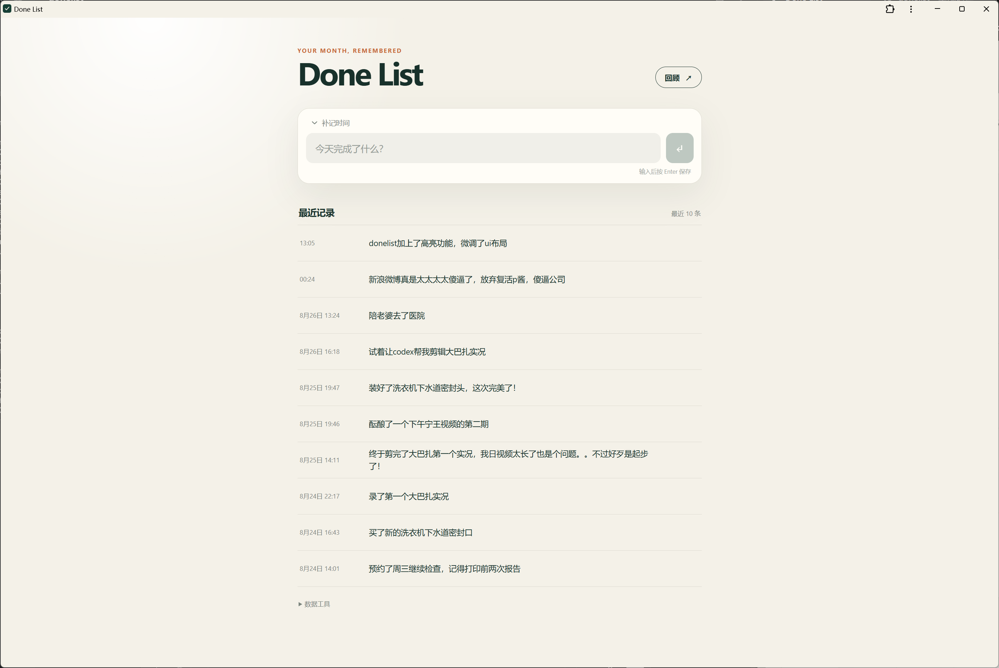
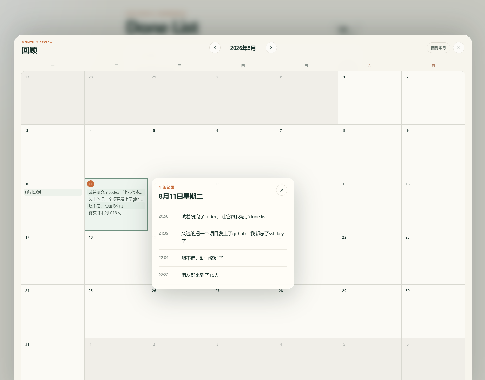

# Done List

你有没有这样的经历：

生活中有太多细碎的事情，一旦做完我们就立刻忘记了。明明觉得每天都忙前忙后，到了月末、季末、年末，要回顾，要写总结时，却总是脑袋空空，完全想不起过去一段时间我们究竟都做了些什么？

反正我是这样。

所以我让 ChatGPT 帮我制作了这个快速记录工具。打开页面、输入一句话、回车，就可以毫无负担地把当下的想法、刚刚做完的事记录下来。

## 大概长啥样




## 本地运行

需要 Node.js 20.19+ 或 22.12+。

将 `.env.example` 复制为 `.env.development.local`，填写 Supabase 项目 URL 和 Publishable Key，此项目暂时必须配置 `VITE_SUPABASE_URL` 和 `VITE_SUPABASE_PUBLISHABLE_KEY` 才能启动。

```bash
pnpm install
pnpm dev --host 127.0.0.1 --port 5173 --strictPort
```

浏览器访问 `http://127.0.0.1:5173/`。不要改用 `localhost`，IndexedDB 数据与完整来源地址绑定。


## 数据结构

每条记录包含稳定 UUID，以及 `happenedAt`、`createdAt`、`updatedAt` 三个 ISO 时间字段。页面通过 `RecordRepository` 接口访问数据，IndexedDB 始终负责本地即时读写。

未登录时，数据只保存在当前浏览器中；顶部同步按钮提供登录、注册、导出与导入功能。登录后，本地数据会自动合并到当前账户并与 Supabase 同步。

## Supabase 数据库

在 Supabase Dashboard 打开 SQL Editor，执行 [`supabase/schema.sql`](supabase/schema.sql)。该脚本会创建 `records` 表、索引和 Row Level Security 策略，确保登录用户只能访问自己的记录。
